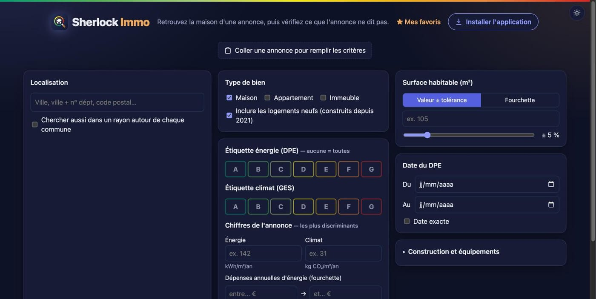
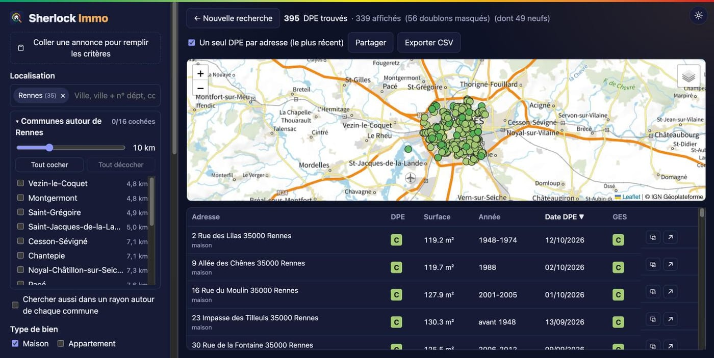
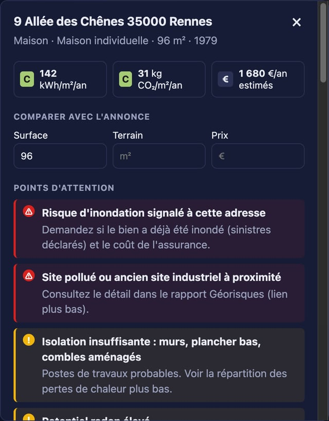

<p align="center">
  
</p>

<h1 align="center">Sherlock Immo</h1>

<p align="center">
  Retrouvez la maison d'une annonce immobilière, puis vérifiez tout ce que l'annonce ne dit pas.<br />
  Gratuit, open source, sans compte, uniquement avec les données publiques françaises.
</p>

<p align="center">
  <a href="https://github.com/Mateus17/sherlock-immo/actions/workflows/deploy.yml"></a>
  <a href="LICENSE"></a>
  <a href="CHANGELOG.md"></a>
</p>

<p align="center">
  <a href="https://mateus17.github.io/sherlock-immo/"><strong>Ouvrir l'application</strong></a>
  · <a href="docs/GUIDE.md">Guide d'utilisation</a>
  · <a href="docs/ARCHITECTURE.md">Comment c'est fait</a>
  · <a href="CONTRIBUTING.md">Contribuer</a>
</p>

<p align="center">
  
</p>

---

## Pourquoi

Une annonce affiche une ville, une surface et les chiffres du DPE, mais rarement l'adresse. Pour savoir si la maison vaut le déplacement, il faut souvent demander à l'agence ou visiter.

Or ces chiffres sont publics. Depuis 2021, chaque DPE est enregistré par l'ADEME avec son adresse. Sherlock Immo s'en sert pour retrouver le bien, puis croise d'autres bases publiques pour répondre aux questions d'un acheteur : le DPE est-il crédible ? La surface est-elle juste ? Le prix est-il cohérent ? Y a-t-il un risque caché ?

## Ce que fait l'application

**Retrouver le bien**

- **Collez le texte de l'annonce** : ville, surface, étiquettes, consommation, émissions, dépenses d'énergie, prix et terrain sont repérés et remplissent les critères. L'analyse se fait dans votre navigateur.
- Par **commune** (plusieurs possibles, avec les communes voisines à cocher), **étiquettes DPE et GES**, **surface habitable** (valeur ± tolérance) et **date du DPE**.
- Par **construction et équipements** : période de construction, énergie de chauffage, pompe à chaleur, plain-pied, panneaux photovoltaïques, bon confort d'été.
- Par les **chiffres exacts de l'annonce** : consommation (kWh/m²/an), émissions (kg CO₂/m²/an) et dépenses annuelles d'énergie. Ce sont les critères les plus efficaces : deux chiffres suffisent souvent pour tomber sur une seule maison.
- Résultats sur une carte (plan ou photo aérienne IGN, points regroupés) et dans un tableau, avec export CSV.
- **Partagez une recherche par lien** : les critères sont dans l'adresse de la page.

<p align="center">
  
</p>

**Vérifier le bien** (fiche détaillée)

- **Historique des DPE de l'adresse** : étiquette améliorée en quelques mois, surface qui change d'un DPE à l'autre, DPE refait sans nouvelle visite, DPE d'avant 2021.
- **Surface** du DPE comparée à celle de l'annonce et à la **surface déclarée aux impôts** lors de la dernière vente.
- **Ventes passées** de la parcelle (prix payé par le vendeur) et **prix au m² du quartier**.
- **Terrain** : surface cadastrale et contour de la parcelle.
- **Travaux** : qualité d'isolation paroi par paroi, répartition des pertes de chaleur, chauffage, ventilation, et l'**audit énergétique** chiffré quand il existe.
- **Risques** (inondation, argiles, radon, sols pollués…) et **urbanisme** (zone du PLU, zones constructibles à proximité).
- Liens vers la vue de rue, la photo aérienne et les photos aériennes anciennes (pour repérer une extension).
- **Questions à poser lors de la visite**, générées à partir des points d'attention, et **dossier imprimable** (ou en PDF) de la fiche.

**Comparer**

- **Favoris** avec notes et prix de l'annonce, gardés dans votre navigateur.
- **Comparateur** de 2 ou 3 logements côte à côte : énergie, facture, surface, chauffage, isolation, prix au m².

<p align="center">
  
</p>

Chaque point d'attention est un **signal**, pas une preuve : il indique quelle question poser au vendeur ou à l'agence.

<sub>Captures : adresses et chiffres remplacés par des valeurs fictives.</sub>

## Utiliser l'application

- **Dans le navigateur** : [mateus17.github.io/sherlock-immo](https://mateus17.github.io/sherlock-immo/)
- **Sur iPhone** : ouvrez le lien dans Safari, puis *Partager → Sur l'écran d'accueil*.
- **Sur Android** : ouvrez le lien dans Chrome, puis *Installer l'application*.
- **Sur Mac ou PC** : dans Chrome ou Edge, cliquez sur **« Installer l'application »** (sur la page d'accueil ou dans la barre d'adresse). Elle s'ouvre ensuite dans sa propre fenêtre, depuis le Dock ou le menu Démarrer.

Le [guide d'utilisation](docs/GUIDE.md) détaille comment passer d'une annonce à une adresse, puis lire la fiche.

## Données utilisées

Il n'y a ni serveur, ni compte, ni clé d'API, et rien de ce que vous cherchez n'est enregistré ailleurs que dans votre navigateur.

Les **DPE de maisons** sont copiés chaque semaine avec le site (un fichier par commune) : la recherche de maisons ne dépend d'aucun quota. Le reste (appartements, détail d'une fiche, ventes, risques…) est interrogé directement depuis votre navigateur auprès des services publics.

| Données | Producteur | Licence |
|---|---|---|
| DPE logements existants, neufs, d'avant 2021, audits énergétiques | [ADEME](https://data.ademe.fr) | Licence Ouverte 2.0 |
| Ventes immobilières (DVF) | DGFiP, via l'[application DVF d'Etalab](https://app.dvf.etalab.gouv.fr) | Licence Ouverte 2.0 |
| Cadastre, zonage d'urbanisme | IGN, [API Carto](https://apicarto.ign.fr) | Licence Ouverte 2.0 |
| Risques | [Géorisques](https://www.georisques.gouv.fr) | Licence Ouverte 2.0 |
| Communes | [API Géo](https://geo.api.gouv.fr) | Licence Ouverte 2.0 |
| Fonds de carte | [IGN Géoplateforme](https://geoservices.ign.fr) | Licence Ouverte 2.0 |

Sherlock Immo n'est affilié à aucun de ces organismes.

## Limites

- Seuls les logements ayant eu un DPE depuis juillet 2021 sont retrouvables. Une maison jamais diagnostiquée récemment n'apparaîtra pas.
- L'adresse du DPE est celle saisie par le diagnostiqueur, puis géocodée : elle peut être approximative.
- Les ventes (DVF) couvrent les cinq dernières années et ne comptent ni les ventes en Alsace-Moselle ni celles à Mayotte.
- Les estimations (facture d'énergie, coût des travaux) sont celles des diagnostics, pas des devis.
- Les maisons sont à jour **à la semaine** (copie du dimanche) ; les appartements, en direct.
- L'API de l'ADEME limite le temps de calcul par utilisateur. Les maisons n'en dépendent plus ; pour le reste, l'application attend et réessaie toute seule si besoin.
- Ce n'est pas un conseil juridique ni financier. Vérifiez auprès des professionnels concernés (notaire, diagnostiqueur) avant toute décision.

## Développement

Prérequis : Node.js 20.19 ou plus récent (22.12 ou plus pour la branche 22).

```bash
npm install
npm run dev        # http://localhost:5173
npm test           # tests unitaires (Vitest)
npm run lint       # ESLint
npm run format     # Prettier
npm run build      # vérification des types + build statique dans dist/
npm run donnees -- --departements 35   # données hébergées d'un département, pour le développement
```

L'organisation du code, les API et les règles de vérification sont décrites dans [docs/ARCHITECTURE.md](docs/ARCHITECTURE.md).

### Icônes

Le logo est un SVG unique, `public/icons/icon.svg`. `npm run icons` en génère les déclinaisons PNG (Android, iOS, favicon) et l'image d'aperçu des liens partagés (`public/og.png`).

### Publication

Chaque dimanche, le workflow [Données hébergées](.github/workflows/donnees.yml) reconstruit la copie des DPE de maisons (environ 2 h) et republie le site. Dans un fork, lancez-le une première fois à la main (onglet *Actions*) ; en attendant, le site utilise l'API de l'ADEME.

Chaque pull request est vérifiée (tests, types, build : [workflow](.github/workflows/ci.yml)). Chaque push sur `main` construit le site et le publie sur GitHub Pages ([workflow](.github/workflows/deploy.yml)). Les nouveautés sont listées dans le [CHANGELOG](CHANGELOG.md). Comme tous les chemins sont relatifs, le dossier `dist/` fonctionne aussi tel quel sur n'importe quel hébergement statique (Netlify, Cloudflare Pages…).

## Contribuer

Les retours, idées et corrections sont bienvenus : voir [CONTRIBUTING.md](CONTRIBUTING.md).

## Licence

[MIT](LICENSE). Les données restent soumises à la licence de leurs producteurs (voir le tableau ci-dessus).
